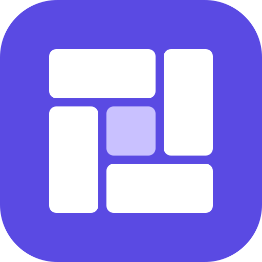
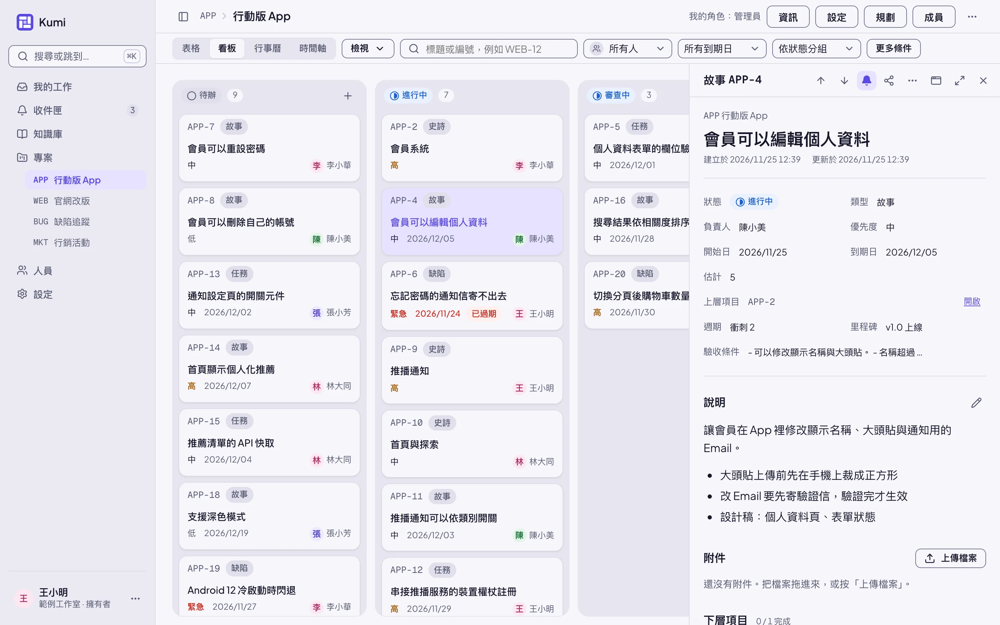
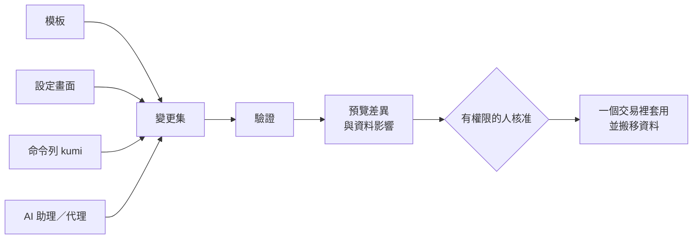
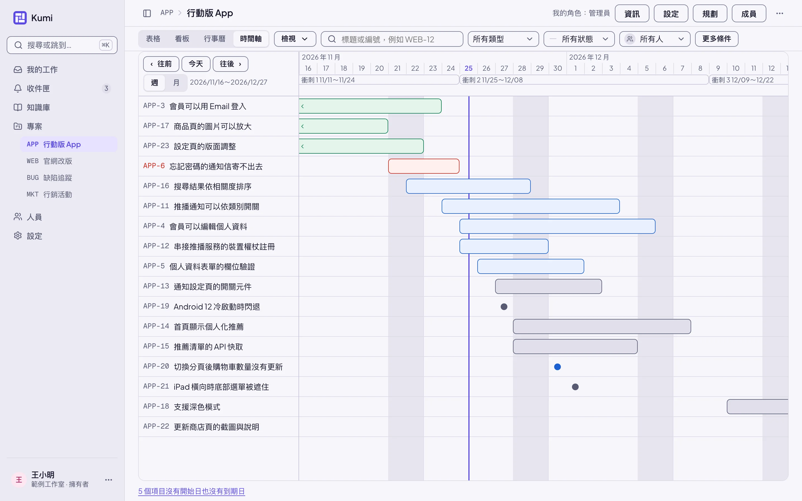
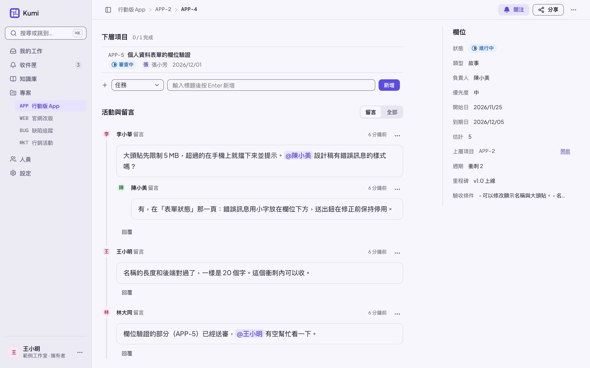
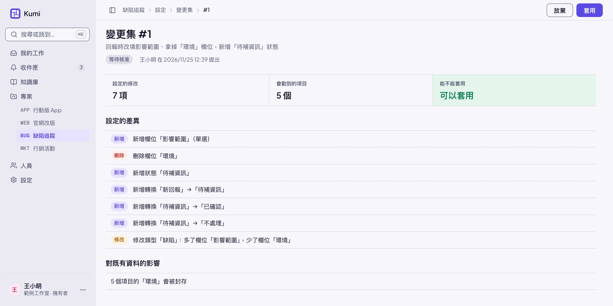
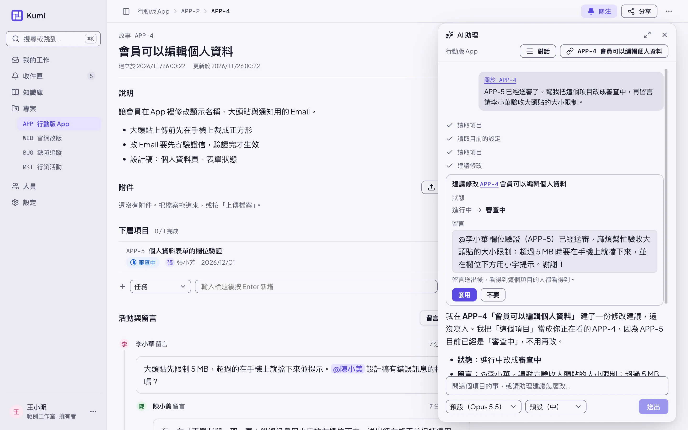
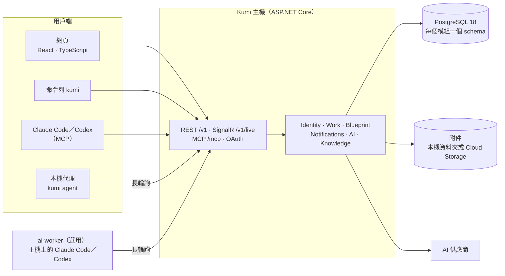

<div align="center">



# Kumi

**把團隊管專案的方式，寫成一份有版本、能驗證、能預覽的藍圖。**

可以自己架的專案管理工具：表格、看板、行事曆、時間軸、知識庫，<br>
加上命令列 `kumi`、MCP 與 AI 助理。AI 只能提出修改，按下套用的永遠是人。

[](https://github.com/OmarHung/kumi/actions/workflows/ci.yml)
[](LICENSE)
[](global.json)
[](web/package.json)
[](compose.yaml)
[](#快速開始)
[](https://github.com/OmarHung/kumi/commits/main)

[快速開始](#快速開始) · [功能](#功能) · [命令列](docs/CLI.md) · [MCP](docs/MCP.md) · [部署](docs/DEPLOYMENT.md) · [文件](#文件) · [路線圖](#路線圖) · [參與](#參與) · [授權](#授權)

<sub>**English:** Kumi is a self-hostable, source-available project management tool. Each project's workflow lives in a versioned blueprint, and every change is validated, previewed and approved before it is applied. The UI and docs are in Traditional Chinese.</sub>

</div>

<p align="center">
  <picture>
    <source media="(prefers-color-scheme: dark)" srcset="docs/assets/readme/hero-dark.webp">
    
  </picture>
</p>

<p align="center"><sub>看板與項目面板。截圖裡的組織、人員與專案都是範例資料。</sub></p>

---

## Kumi 是什麼

每個團隊管專案的方式都不一樣：接案的要「等客戶」，追缺陷的要分嚴重度，產品團隊要跑衝刺。多數工具把這些藏在一層層的設定畫面裡，改了什麼、誰改的、會動到多少既有的項目，事後都很難說清楚。

Kumi 把「這個專案怎麼管」做成一份資料，稱為**藍圖**：欄位、流程（狀態與轉換）、項目類型、檢視、角色都在裡面。它有版本、可以用 JSON Schema 驗證、可以和上一版比對差異。從模板開專案、在設定頁改流程、用命令列改檔、讓 AI 提建議，四個入口送出的都是同一種東西，走同一條管線：



拿掉一個還有項目的狀態？預覽會先列出會動到幾筆、要搬去哪裡；套用時資料一起搬好，每個被動到的項目都留下活動紀錄。

### 適合的情況

- 一個組織裡有幾種性質不同的專案（例如接案、缺陷追蹤、衝刺開發），各自需要自己的狀態、欄位與規則。
- 資料要留在自己的主機上，用 Docker 自己架。
- 想讓 AI 幫忙整理項目、調整流程，但每一筆修改都要有人看過才算數。
- 習慣用命令列、腳本或 CI 操作工作項目。

### 可能不適合的情況

- 要多人即時共同編輯文件：說明與知識庫是存檔時檢查衝突，沒有即時協作。
- 要原生的手機 App：只有網頁版（手機的瀏覽器能用）。
- 介面要英文或其他語言：目前只有繁體中文。
- 不想自己架：目前沒有官方代管的版本。

---

## 功能

### 管工作

- **四種版面** — 表格（在格子裡直接改核心欄位與自訂欄位）、看板（拖到別欄就是改狀態，也能依負責人或單選欄位分組）、行事曆、時間軸。四種吃同一套篩選，可以存成個人的「檢視」。
- **流程會擋人** — 不合轉換規則的改狀態會被擋下並說明原因；轉換可以限角色、要求先填某些欄位，被擋下時原地補填。
- **12 個內建模板** — 接案專案、客戶維運、簡單任務看板、Scrum 衝刺、行銷活動與內容行事曆、缺陷追蹤、產品路線圖、設計專案、需求管理、發行與上線檢查、維運與事故、會議與決議追蹤；開專案時可以附上範例項目。
- **我的工作** — 跨專案列出自己負責、還沒結束的項目，一樣有四種版面與檢視。
- **規劃** — 週期（衝刺）與里程碑，看得到完成數與估計的總和。
- **找得到** — ⌘K 快速跳轉、依類型／狀態／負責人／到期／優先度與自訂欄位篩選、專案搜尋比對代號、名稱與專案說明。

<p align="center">
  
</p>

### 一起做

- **所見即所得，存的是 Markdown** — 說明與留言用 Tiptap 編輯，截圖直接貼上或拖進來，`@` 提及成員。
- **留言** — 一層回覆；自己的留言可以編輯（看得到歷次版本），刪除後留在原位、可以復原。
- **通知** — 站內的收件匣、新通知的提示、Email 通知（Gmail 或自己的 SMTP，沒讀才寄、同一個人的併成一封），每個人可以關掉。
- **即時更新** — 別人改了項目，你的畫面跟著更新（SignalR）。
- **角色與權限** — 專案的角色可以自訂；內建的「執行者」只看得到自己負責或建立的項目，看不到的一律當作不存在。
- **知識庫** — 組織與專案的空間、頁面樹、往下繼承的頁面限制、垃圾桶（第一段，見[目前的狀態](#目前的狀態)）。
- **專案資訊頁** — 專案的網址、部署環境、主機這類資料寫成一份 Markdown，有組織自己的說明格式；私鑰會被擋下。

<p align="center">
  
</p>

### 藍圖：流程就是設定

- 設定頁改狀態、轉換（每條可以限角色與要先填的欄位）、類型、欄位與自訂角色，送出成一份變更集；預覽頁列出差異與會動到多少既有資料，核准後才套用。

<p align="center">
  
</p>

- 格式的唯一依據是 [`schemas/blueprint/v0/`](schemas/blueprint/v0/) 的 JSON Schema；也能匯出成 YAML 檔，改完再用命令列預覽、套用：

```yaml
apiVersion: blueprint/v0
kind: ProjectBlueprint
metadata: { key: bug_tracking, name: 缺陷追蹤 }
fields:
  - key: severity
    name: 嚴重度
    type: single_select
    options:
      - { key: critical, name: 致命, color: red }
      - { key: normal,   name: 一般, color: yellow }
workflows:
  - key: bug_flow
    name: 缺陷流程
    states:
      - { key: reported,  name: 新回報, category: not_started }
      - { key: fixing,    name: 修正中, category: in_progress }
      - { key: verifying, name: 待驗證, category: in_progress }
      - { key: closed,    name: 已關閉, category: done }
    transitions:
      - { from: reported,  to: fixing }
      - { from: fixing,    to: verifying }
      - { from: verifying, to: fixing }    # 驗證沒過，退回修正
      - { from: verifying, to: closed }
itemTypes:
  - { key: bug, name: 缺陷, workflow: bug_flow, fields: [severity] }
```

<sub>節錄自內建的「缺陷追蹤」模板，完整的在 [`src/Modules/PmTool.Work/Templates/`](src/Modules/PmTool.Work/Templates/)。</sub>

### AI，但由人決定

- **內建的 AI 助理** — 接 Anthropic、OpenAI、Google Gemini、OpenRouter 或 OpenAI 相容的端點；組織管理員接組織的，也可以開放成員接自己的帳號。每一頁右下角都叫得出來。
- **只提出、不寫入** — 助理能做的最多是提出藍圖的變更集或項目的修改建議，你在卡片上按「套用」，才以你自己的身分、照你的權限寫入。

<p align="center">
  
</p>

- **MCP 伺服器** — `/mcp` 讓你電腦上的 Claude Code／Codex 用自己的訂閱、以 Kumi 帳號授權（OAuth 2.1 加 PKCE）連進來，權限等於授權的人。見 [docs/MCP.md](docs/MCP.md)。
- **本機代理** — `kumi agent start` 讓網頁的助理改用你電腦上的 Claude Code／Codex 回答，伺服器不連進你的電腦，引擎只拿得到限定的工具。
- **主機 AI 代理**（選用）— 組織擁有者在主機上常駐一套 Claude Code／Codex 給全組織用，只接受 API 用量計費的登入。見 [docs/OPERATIONS.md](docs/OPERATIONS.md) 第 17 節。

### 命令列與自動化

- **`kumi`** — 查詢、建立、修改項目與改狀態；匯出藍圖、改檔、預覽差異與資料影響、套用；處理變更集。輸出可以是 JSON，結束代碼固定，CI 裡也能用。見 [docs/CLI.md](docs/CLI.md)。
- **`kumi setup`** — 開瀏覽器按「允許」就登入，順便替 Claude Code／Codex 加好 MCP 與本機代理。
- **下載即用** — 伺服器內含 macOS（Apple 晶片、Intel）與 Windows 的單一執行檔，不用裝 .NET；`kumi update` 自己更新。
- **個人存取權杖** — 給腳本用，可以限定範圍（`items:read`、`items:write`、`blueprint:read`、`blueprint:write`）與期限，隨時撤銷。
- **從 monday 搬過來** — `kumi import monday fetch|plan|run`，保留作者與時間、留言與附件，可以重跑。
- **給 AI 代理的 skill** — [`skills/`](skills/) 教 Claude Code、Codex 這類代理怎麼用 `kumi` 與怎麼規劃專案；`kumi skill install` 一行裝好，跟著 `kumi update` 更新。

### 自己架、自己管

- 一個 API 容器加 PostgreSQL，`docker compose` 就跑得起來；上雲照 [docs/DEPLOYMENT.md](docs/DEPLOYMENT.md)（Cloud Run 加 Cloud SQL，或 VM 加反向代理）。
- 每日自動備份、在用完就丟的資料庫裡演練還原、一行指令看狀態與錯誤，見 [docs/OPERATIONS.md](docs/OPERATIONS.md)。
- 資料庫分成執行用與擁有資料表的兩個角色；工作階段存在伺服器，登出、改密碼、停用帳號在下一個請求就生效。

---

## 快速開始

需要 [Docker](https://www.docker.com/)。

```bash
git clone https://github.com/OmarHung/kumi.git
cd kumi
cp .env.example .env               # 打開 .env 填好三個密碼（見下面）再往下
bash scripts/ops/deploy-local.sh   # 先備份再建置、啟動，等到就緒
```

`.env` 要填的三個密碼：`POSTGRES_PASSWORD` 與 `POSTGRES_APP_PASSWORD` 各用 `openssl rand -hex 24` 產生一組，`BOOTSTRAP_ADMIN_PASSWORD` 是第一個擁有者的登入密碼（至少 10 個字元）。

然後開 <http://localhost:8080>，用 `.env` 裡的 `BOOTSTRAP_ADMIN_EMAIL` 與 `BOOTSTRAP_ADMIN_PASSWORD` 登入，從模板開第一個專案。

<details>
<summary><b>本機執行的注意事項</b></summary>

<br>

- 連接埠只綁本機（`127.0.0.1:8080`），而且沒有 HTTPS，不要直接放到網路上；要上雲或放到網路上，照 [docs/DEPLOYMENT.md](docs/DEPLOYMENT.md)。
- 資料放在 Docker 的資料卷裡，`docker compose down` 之後還在；`docker compose down -v` 會把資料庫整個刪掉（備份在 `backups/`，刪不到）。之後更新也用 `deploy-local.sh`，它會先備份。
- 第一個擁有者只在資料庫裡還沒有任何帳號時建立；之後改 `.env` 裡的那幾個值不會有作用。
- 空的資料庫第一次啟動時，記錄裡會有兩筆查不到遷移紀錄表的 `fail`，那是在確認資料表還不存在，可以忽略。
- 每日備份、還原演練、還原、看錯誤、`bash scripts/ops/status.sh` 一眼看狀態，都寫在 [docs/OPERATIONS.md](docs/OPERATIONS.md)。

</details>

### 接上命令列

登入網頁後，到「設定 → 命令列與整合」下載 `kumi`，照頁面上的指令裝好，然後：

```bash
kumi setup                                          # 開瀏覽器按「允許」登入，順便設定 Claude Code／Codex
kumi item list --project WEB --mine                 # 我負責的項目
kumi item create -p WEB --type task --title "改首頁" --assignee @me
kumi item move WEB-12 --to doing                    # 改狀態，照流程的規則
kumi blueprint export --project WEB -o web.yaml     # 把專案的藍圖匯出成檔案
kumi blueprint plan -f web.yaml                     # 改完先預覽差異與資料影響，什麼都不存
kumi blueprint apply -f web.yaml                    # 送出；有權限就直接套用
```

---

## 架構

模組化單體：每個模組一個專案、自己的 `DbContext`、自己的 schema 與遷移，模組之間只透過 `*.Contracts` 的公開介面互相使用；`src/PmTool.Api` 是唯一的組合根，也負責提供網頁的靜態檔。



| 層 | 技術 |
| --- | --- |
| 後端 | ASP.NET Core（.NET 10）、EF Core、SignalR、Microsoft.Extensions.AI、MCP 官方 C# SDK |
| 資料庫 | PostgreSQL 18 |
| 網頁 | React 19、TypeScript、Vite、TanStack Query／Table、Tiptap、dnd-kit |
| 命令列 | .NET；單一執行檔（macOS、Windows）或 dotnet tool |
| 測試 | NUnit、Testcontainers（真的 PostgreSQL）、Vitest、Testing Library、MSW |
| 部署 | 容器：Docker Compose、Cloud Run 加 Cloud SQL、VM 加反向代理 |

<details>
<summary><b>目錄結構</b></summary>

```
schemas/blueprint/v0/     藍圖格式第 0 版：兩份 JSON Schema 與範例
src/PmTool.Api/           ASP.NET Core 主機，唯一的組合根；也負責提供網頁的靜態檔
src/PmTool.Cli/           命令列工具 kumi，只透過公開的 API 與權杖操作
src/Modules/              各模組，每個模組一個專案；*.Contracts 是模組對外的介面
  PmTool.Blueprint/       藍圖的讀取、驗證與計畫（純邏輯，不碰資料庫與網路）
  PmTool.Identity/        組織、人員、登入、存取權杖、OAuth
  PmTool.Work/            專案、藍圖版本、成員、工作項目、事件流
  PmTool.Notifications/   關注、通知、收件匣、Email 通知
  PmTool.Ai/              AI 設定、助理、本機代理與主機 AI 代理
  PmTool.Knowledge/       知識庫的空間與頁面
src/Shared/               各模組共用的基本型別、HTTP 與檔案儲存
web/                      網頁版（React、TypeScript、Vite）
skills/                   給 AI 代理用的 skill
tests/                    每個專案對應一個測試專案
docs/                     使用、部署、維運與設計規範的文件
deploy/ai-worker/         主機 AI 代理的映像檔
Dockerfile、compose.yaml   容器映像檔與本機執行的設定
```

</details>

---

## 文件

| 我想… | 從這裡開始 |
| --- | --- |
| 第一次在網頁上用 Kumi | [docs/guide/quick-start.md](docs/guide/quick-start.md) · [使用手冊](docs/guide/) |
| 在自己的電腦上跑起來、備份、還原 | [快速開始](#快速開始) · [docs/OPERATIONS.md](docs/OPERATIONS.md) |
| 架到雲端或自己的主機 | [docs/DEPLOYMENT.md](docs/DEPLOYMENT.md) · [docs/deployment/vm.md](docs/deployment/vm.md) |
| 用命令列、寫腳本、接 CI | [docs/CLI.md](docs/CLI.md) |
| 讓 Claude Code／Codex 連進來 | [docs/MCP.md](docs/MCP.md) |
| 讓 AI 代理學會用 Kumi | [skills/](skills/) · [docs/CLI.md「給 AI 代理用」](docs/CLI.md#給-ai-代理用) |
| 看懂藍圖的格式 | [schemas/blueprint/v0/](schemas/blueprint/v0/) |
| 改畫面 | [docs/DESIGN.md](docs/DESIGN.md) · [web/README.md](web/README.md) |
| 參與開發 | [CONTRIBUTING.md](CONTRIBUTING.md) |
| 回報弱點 | [SECURITY.md](SECURITY.md) |

---

## 開發

需要 .NET SDK 10（版本鎖在 [`global.json`](global.json)）、Node 24、Docker（身分、工作引擎與端到端的測試會用 Testcontainers 起一個 PostgreSQL）。產品名稱是 Kumi，repo 裡的程式代號照舊是 pm-tool／PmTool（命名空間、資料庫的 schema 這些）。

```bash
dotnet build
dotnet test
dotnet test /p:CollectCoverage=true /p:Threshold=80 /p:ThresholdType=line
```

網頁：

```bash
cd web
npm install
npm run dev            # http://localhost:5173，/v1 與 /health 代理到 http://localhost:8080
npm run typecheck && npm run lint && npm run test:coverage && npm run build
```

資料表的修改用 EF Core 的遷移，每個模組各自一份：

```bash
dotnet tool restore
dotnet ef migrations add <名稱> --project src/Modules/PmTool.Work --output-dir Persistence/Migrations
```

產生出來的檔案帶 BOM 與 `#pragma warning disable`，提交前要拿掉（這個 repo 不允許關閉警告）。送出前要過的檢查與程式的規矩見 [CONTRIBUTING.md](CONTRIBUTING.md)。

---

## 目前的狀態

Kumi 還在快速開發，沒有發布正式的版本；自己架的請跟著 `main` 更新（步驟在 [docs/OPERATIONS.md](docs/OPERATIONS.md) 與 [docs/DEPLOYMENT.md](docs/DEPLOYMENT.md)）。

- 知識庫是第一段：網頁上能用，命令列、MCP、通知與即時更新還沒做。
- 網頁的已知限制列在 [web/README.md](web/README.md#已知的限制)。

---

## 路線圖

這裡寫的是方向，不是承諾，順序會依實際使用的情形調整。想要的功能不在這裡，歡迎開 [issue](https://github.com/OmarHung/kumi/issues)。

**接下來**

- **英文介面**：網頁、伺服器的訊息、信件、命令列、內建模板與 AI 助理都能用英文；架構保留再加其他語言的空間。
- **知識庫的後續**：
  - 版本歷史與還原、頁面留言、頁面模板、搜尋。
  - 接上命令列、MCP（讓 AI 代理讀得到文件）、通知與即時更新。

**之後**

- **自動化規則**：藍圖裡已經寫得出的 `automations` 會真的執行。
  - 觸發：項目的事件、排程。
  - 動作：改狀態、設欄位、通知。
  - 有執行紀錄與設定畫面。
- **Webhook 與整合**：
  - 對外的 webhook。
  - 第一個整合是 GitHub：PR 連到項目，合併時把項目推到下一個狀態。
  - 再來是通知類的聊天軟體。
- **表單**：專案外的人也能送進項目。
- **AI 成員**：
  - 專案裡的 AI 成員被 @提及、交辦或自動化規則叫到時，自己開始整理項目，不用有人在對話框裡送出訊息。
  - 一樣只提出建議，由人按套用。
  - 它不當負責人。
- **多組織與帳號**：註冊與邀請、單一登入、雙重驗證。
- **手機**：先做能安裝到主畫面的網頁版（PWA）。
- **規劃**：工作負載、儀表板、項目之間的相依關係、在時間軸上拖曳改日期。

**目前不打算做**

- 一個項目多位負責人：一個項目一位負責人，責任才清楚。
- 多人即時共同編輯：說明與知識庫是在存檔時檢查衝突。
- Homebrew：`kumi` 從你自己架的伺服器下載與更新，那裡的下載要登入，Homebrew 的 formula 只能從公開網址下載。

---

## 參與

- **回報錯誤、提功能需求**：開 [issue](https://github.com/OmarHung/kumi/issues)，繁體中文或英文都可以。
- **送 Pull Request**：先讀 [CONTRIBUTING.md](CONTRIBUTING.md)。它說明貢獻的授權條件、送出前要過的檢查與程式的規矩；新功能與對外合約的修改請先開 issue 討論。
- **發現弱點**：照 [SECURITY.md](SECURITY.md) 私下回報，不要開公開的 issue。

程式註解與文件裡指到 `internal/`（例如 `internal/HANDOFF-*.md`）的是不公開的開發紀錄，放在另一個私人的 repo，外面的人打不開；行為以程式、測試與 `docs/` 的文件為準。

### 為什麼叫 Kumi

Kumi（くみ）是日文的「組」：一組一起做事的人。

---

## 授權

Kumi 以 [Kumi License](LICENSE) 提供：Apache License 2.0 加上附加條件。原始碼公開，但它不是 OSI 定義的開源授權。

不用另外取得許可就可以：

- 在自己的組織裡使用，包括商業用途；開幾個組織、幾個專案都可以。
- 邀客戶、廠商、合作夥伴當訪客，進你自己的 Kumi 一起做你們的專案。
- 替別的組織安裝、設定、維護它自己營運的那一套（架在對方自己掌控的環境、由對方自己管理），收不收費都可以，按月收維護費也行。
- 修改，以及公開修改後的原始碼。
- 自己寫商業軟體，透過 API、命令列或 MCP 和 Kumi 串接，連到使用者自己營運的 Kumi（不把 Kumi 包進去、也不是自己架一套 Kumi 再包一層賣）。
- 調整畫面的版面與配色，只要 Kumi 的名稱、Logo 與版權標示還在原本或相當的位置、清楚看得到。

需要商業授權或品牌豁免的：

- 對組織以外的人提供代管服務（免費的、和顧問服務綁在一起的也算），或是替別的組織營運：架在你自己的主機上替客戶跑、替客戶管理工作區、收訂閱費或按人數與用量收費都算。
- 把 Kumi 嵌進要賣、要授權出去的產品或服務，拿掉或換掉畫面、只用後端的也算。
- 拿掉或改掉畫面上的 Kumi 名稱、Logo 與版權標示。

違反條件時，授權在違反的當下自動終止；第一次被通知的違反在 30 天內停止並完全改正，授權就恢復。準據法是中華民國（臺灣）法律，第一審由臺灣臺北地方法院管轄。

這裡是摘要，條文以 [LICENSE](LICENSE) 為準，歸屬的聲明在 [NOTICE](NOTICE)。商業授權與品牌豁免請寄信到 omar40276@gmail.com。

Kumi 用到的第三方套件與它們的授權列在 [THIRD-PARTY-NOTICES.txt](THIRD-PARTY-NOTICES.txt)，映像檔的 `/app` 底下也附了一份；`kumi licenses` 印出同樣的內容（從伺服器下載的單一執行檔把它們內嵌在裡面）。

主機 AI 代理的映像檔（`deploy/ai-worker`）在建置時會安裝 Claude Code 與 Codex。它們不屬於 Kumi，各有自己的授權，其中 Claude Code 適用 Anthropic 的條款、不能轉散布：請用這裡的 Dockerfile 自己建，不要散布建好的映像檔。
